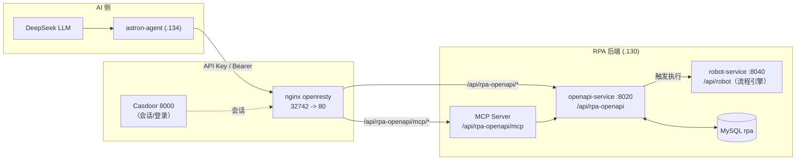

# 开发文档：AI 操作 RPA — OpenAPI 集成与流程编排

> 目标：让外部 AI（如 `.134` 的 astron-agent + DeepSeek）通过 Astron RPA 的 OpenAPI / MCP 接口，对 `192.168.76.130` 上的 RPA 服务做**流程查询、执行触发**，并为后续「AI 生成节点级流程（路线 B）」预留接口。

## 文档信息

| 项目 | 内容 |
| --- | --- |
| 文档编号 | DEV-ASTRON-RPA-OPENAPI-001 |
| 版本 | v1.5（+**Word 二次运行必挂/空白窗口两个平台坑**：§14.14.8） |
| 编写日期 | 2026-10-29（更新 2026-10-30） |
| 适用服务 | `rpa-opensource-openapi-service`（`.130`），及 nginx 网关 |
| 对接方 | `192.168.76.134` astron-agent（AI 大脑，可配 DeepSeek） |
| 状态 | 可用于联调（鉴权方式已确认；具体 Key 见 §4 备注） |

---

## 1. 背景与目标

Astron RPA 已有完整后端（`robot-service` 流程引擎 + `openapi-service` 对外接口 + 内置 MCP Server）。本集成要解决两件事：

| 路线 | 目标 | 现状 |
| --- | --- | --- |
| **A. 调度已建流程** | AI 查询并触发已搭建好的 RPA 流程 | ✅ openapi / MCP 原生支持 |
| **B. AI 搭建流程** | AI 根据自然语言生成节点级流程并新建 | ⚠️ openapi `upsert` 不含节点；节点级创建在 `robot-service /robot-design`，需桌面会话 |

本文档先覆盖 **A（可立即联调）**，并给出 **B 的接口边界与后续路径**。

---

## 2. 术语

| 术语 | 含义 |
| --- | --- |
| OpenAPI | `openapi-service`，对外 REST 接口（FastAPI，容器内 8020，经 nginx 暴露） |
| MCP | Model Context Protocol Server，`openapi-service` 内置，供任意 MCP 客户端调用 RPA |
| API Key | 外部集成的凭据，`Authorization: Bearer` 或 `X-API-Key` 传递 |
| Session | Casdoor 桌面会话令牌，用于控制台/私有网关内的管理类接口（如 upsert） |
| ProcessNode | RPA 工作流的节点数据模型 `{id, type, ...params}`，树形结构 |
| 原子（Atom） | 流程中的最小动作单元，`type` 取自固定词汇表（`Code.*`、`CV.*`、`BrowserElement.*` 等） |

---

## 3. 系统架构



---

## 4. 环境与凭证

### 4.1 访问地址

| 项 | 值 |
| --- | --- |
| 网关入口 | `http://192.168.76.130:32742` |
| OpenAPI Base | `http://192.168.76.130:32742/api/rpa-openapi` |
| MCP Base | `http://192.168.76.130:32742/api/rpa-openapi/mcp/` |
| 控制台/鉴权 | `http://192.168.76.130:8000`（Casdoor） |
| 容器内端口 | openapi `8020`（仅内网，经 nginx 反代） |

> 路由来源：`docker/volumes/nginx/includes/gateway-routes.conf`，`/api/rpa-openapi/` → `rewrite` → `proxy_pass http://openapi-service:8020`。

### 4.2 数据库（运维参考）

| 项 | 值 |
| --- | --- |
| 容器 | `rpa-opensource-mysql` |
| 库 | `rpa` |
| 账号 | `root` / `<DB_PASSWORD>`（内网） |
| 表 | `openai_workflows`、`openai_executions`、`openai_api_keys` 等 |

### 4.3 凭据 ⚠️ 敏感

| 项 | 值 | 说明 |
| --- | --- | --- |
| API Key（已验证 ✅） | `<RPA_API_KEY>` | 控制台「设置中心 → 星辰RPA授权管理」签发（名称 AI，2026-10-29）。实测 `GET /workflows/get` 带 `X-API-Key` / `Bearer` 均返回 **200**。 |
| 桌面会话 | 控制台登录获取（Casdoor） | upsert 等管理接口必须用会话 |

> **安全要求**：API Key 属敏感凭据，禁止提交到公开仓库；本文件中的 Key 仅作本地联调记录，导出/分享前请抹除。

---

## 5. 鉴权机制

外部调用**只允许二选一**的单一凭据（不可重复/冲突头）：

```
Authorization: Bearer <API_KEY>
# 或
X-API-Key: <API_KEY>
```

服务端对 Key 做 bcrypt 校验，绑定 `user_id`（Key / workflow / execution 均按用户隔离）。

### 5.1 授权矩阵（摘自 `EXTERNAL_INTEGRATION_SECURITY.md`）

| 能力 | 凭据类型 | 约束 |
| --- | --- | --- |
| MCP 固定 list/get | API Key | Owner + 外部访问开启 + 有效发布版本；需精确 projectId |
| MCP 动态发现/调用 | API Key | 同上，启动时重校版本 |
| MCP / REST 启动执行 | API Key | 授权项目/当前版本 + 准入范围；仅执行者，无代理身份 |
| MCP 执行 get/cancel；REST 执行 list/get | API Key | 执行 owner + 当前流程 owner + 外部访问开启 |
| **REST 流程 list/get** | **API Key** | 当前 owner 的「开放、已发布」流程 |
| **Key 签发/list/revoke、workflow upsert、Astron 凭据管理** | **桌面会话（私有网关）** | 当前用户；**API Key 不能签发 Key，也不能 upsert** |
| `/workflows/stop-current` | API Key | 停止当前用户运行中的执行 |

> 结论：**AI 用 API Key 可查询/执行，但不能创建或更新流程（upsert 需桌面会话）**。这正是路线 B 需绕到 `robot-service /robot-design` 的原因。

---

## 6. 接口规范

Base：`http://192.168.76.130:32742/api/rpa-openapi`

| 方法 | 路径 | 用途 | 凭据 | 实测 |
| --- | --- | --- | --- | --- |
| GET | `/workflows/get` | 列出当前用户的流程 | API Key / 会话 | ✅ 200 |
| GET | `/workflows/get/{project_id}` | 获取指定流程详情（metadata+参数） | API Key / 会话 | ✅ 200 |
| POST | `/workflows/upsert` | 创建/更新流程（**仅 metadata，不含节点**） | **仅桌面会话** | — |
| POST | `/workflows/execute` | 同步执行流程（超时返 202） | API Key | — |
| POST | `/workflows/execute-async` | 异步执行流程（立即返回任务ID） | API Key | — |
| POST | `/workflows/stop-current` | 停止当前用户运行中的执行 | API Key | — |
| GET | `/workflows/get-astron` | 获取绑定的星辰 Agent 工作流 | 仅会话 | — |
| POST | `/workflows/copy-workflow` | 复制工作流 | API Key | — |
| GET | `/executions/{id}` | 查询执行状态/结果 | API Key | — |
| POST | `/executions/{id}/cancel` | 取消执行 | API Key | — |
| GET/POST | `/mcp/` | MCP（StreamableHTTP） | API Key | — |

> ⚠️ **路径注意**：列表是 `/workflows/get`（不是 `/workflows`）。直接打 `/workflows` 会 401 `Session authentication required`——该路径没有 API Key 回退逻辑。鉴权依赖对照（源码 `routers/workflows.py`）：`/upsert`、`/get-astron` 用 `get_user_id_from_header`（仅会话）；`/get`、`/get/{project_id}` 用 `get_user_id_with_fallback`（API Key 可用）；execute 系列用 `get_user_id_from_api_key`。

### 6.1 实测样本（2026-10-29）

`GET /workflows/get` 返回（1 条流程）：

```json
{
  "code": "0000",
  "data": {
    "total": 1, "personal_total": 1, "public_total": 0,
    "records": [{
      "project_id": "2065231113695461380",
      "name": "沙发上等着",
      "english_name": "1",
      "version": 1,
      "status": 1,
      "parameters": [
        {"varName": "store_name", "varType": "Str", "varDescribe": "商店名称", "varDirection": 0},
        {"varName": "goods_name", "varType": "Str", "varDescribe": "商品名称", "varDirection": 0}
      ],
      "user_id": "b7faea17-12f1-4b6d-9221-15b36919c09b",
      "created_at": "2026-07-29T09:15:13",
      "updated_at": "2026-10-29T08:39:05"
    }]
  }
}
```

> 印证边界：API 返回的只有 **metadata + 入参定义**，**不含节点树**——节点级流程仍在 `robot-service` 内部（路线 B 的边界）。

### 6.1 关键说明

- **`/workflows/upsert` 请求体**（`WorkflowBase`）仅含：`project_id`、`name`、`description`、`version`、`status`、`parameters`(JSON 参数)、`example_project_id`。**没有节点逻辑字段**——不能靠它「搭流程」，只能登记元数据。
- **执行类接口**是路线 A 的核心：拿到 `workflow id` 即可 `execute` 并轮询 `executions/{id}`。
- **MCP** 暴露了 `astron_workflow_list/get/execute` 等工具，支持 MCP 的 AI 客户端可直接接入（对应 OpenClaw 插件的 `get_workflows` / `execute_workflow_sync`）。

---

## 7. 数据模型（路线 B 相关）

工作流本质是 **`ProcessNode` 树**（非自由图）：

```ts
interface ProcessNode {
  id: string;      // 唯一 id
  type: string;    // 原子 key（见下）
  [key: string]: any; // 各原子的参数
  // 树形：通过父/子关系表达层级
}
```

### 7.1 控制流（成对节点）
| 语义 | 开始 | 结束/分支 |
| --- | --- | --- |
| if | `If` | `IfEnd`（`ElseIf`/`Else` 同级） |
| 循环(列表) | `ForList` | `ForListEnd` |
| 循环(步进) | `ForStep` | `ForStepEnd` |
| 循环(字典) | `ForDict` | `ForDictEnd` |
| while | `While` | `WhileEnd` |
| try | `Try` | `TryEnd`（`Catch`/`Finally` 同级） |
| 分组 | `Group` | `GroupEnd` |

### 7.2 领域原子（示例）
`Code.*`（流程控制）、`CV.*`（图像识别）、`File.*` / `Folder.*`（文件）、`Window.*`（窗口）、`Excel.*`（表格）、`BrowserElement.*`（浏览器元素）、`DataTable.*`（数据表）、`Script.*`（脚本）。

> 具体动作原子的**完整目录与参数 schema** 由 `robot-service` 运行时下发（`/atom` 接口），生成流程前应先拉取作为 LLM 的「工具规范」。

### 7.3 创建入口（路线 B 落点）
| 接口 | 服务 | 说明 |
| --- | --- | --- |
| `/robot-design`（创建/重命名/详情/复制/删除/分享） | `robot-service`（`/api/robot`，8040） | **接收含节点的完整流程定义**，是 B 的真正写入点 |
| `/atom` | `robot-service` | 原子目录 + 参数 schema |
| `/element` | `robot-service` | UI 元素库（click/input 的目标定位来源） |

---

## 8. 调用示例（Python）

> 依赖：`requests`。`BASE` 与 `KEY` 按 §4 填写。

```python
import requests, time

BASE = "http://192.168.76.130:32742/api/rpa-openapi"
KEY  = "<RPA_API_KEY>"   # 已验证有效（2026-10-29）
HEAD = {"X-API-Key": KEY}   # 或 {"Authorization": f"Bearer {KEY}"}

# 1) 列出流程（注意：是 /workflows/get，不是 /workflows）
r = requests.get(f"{BASE}/workflows/get", headers=HEAD, timeout=10)
print(r.status_code, r.text[:500])

# 2) 流程详情
r = requests.get(f"{BASE}/workflows/get/{'2065231113695461380'}", headers=HEAD, timeout=10)

# 3) 触发执行（拿到 project_id 后）
def run_workflow(pid, params=None):
    r = requests.post(f"{BASE}/workflows/{pid}/execute",
                      headers=HEAD, json={"parameters": params or {}}, timeout=30)
    r.raise_for_status()
    return r.json()

# 4) 查询执行状态
def get_execution(eid):
    r = requests.get(f"{BASE}/executions/{eid}", headers=HEAD, timeout=10)
    return r.json()

# 5) 异步执行 + 轮询
def run_async(pid, params=None, interval=3, max_try=40):
    r = requests.post(f"{BASE}/workflows/{pid}/execute-async",
                      headers=HEAD, json={"parameters": params or {}}, timeout=30)
    eid = r.json().get("execution_id") or r.json().get("id")
    for _ in range(max_try):
        st = get_execution(eid)
        if st.get("status") in ("succeeded", "failed", "cancelled"):
            return st
        time.sleep(interval)
    raise TimeoutError("execution not finished")
```

### 8.1 MCP 接入（可选）
把 MCP Base（`http://192.168.76.130:32742/api/rpa-openapi/mcp/` + API Key）配置到支持 MCP 的 AI 客户端，即可直接调用 `astron_workflow_list/get/execute`。

---

## 9. 路线 A / B 说明

| | 路线 A（调度） | 路线 B（搭建） |
| --- | --- | --- |
| 能力 | 查询 + 触发已建流程 | AI 生成节点树并新建流程 |
| 接口 | openapi `/workflows*`、MCP | `robot-service /robot-design` |
| 凭据 | API Key | **桌面会话**（+ 元素库/原子目录） |
| 现状 | ✅ 可立即联调 | ⚠️ 需确认 `/robot-design` 请求体与节点落库格式 |
| 关键依赖 | 有效 API Key、已发布流程 | 真实流程样本、`/atom` 目录、`/element` 元素库 |

### 9.1 路线 B 落地建议
1. 从 `.130` 取一个**真实流程的节点树 JSON**（确认 root/坐标/落库形态）；
2. 拉 `/atom`（原子目录 + 参数 schema）与 `/element`（元素库）；
3. 用「注入原子词汇 + 元素库 + schema」的 LLM 生成 `ProcessNode` 树（JSON），并做合法性自检；
4. 走 `/robot-design` 创建 → openapi `execute` 触发，形成闭环。

> 拦路石：click/input 需 UI 元素（xpath/坐标/CV），元素由设计器录制存库；AI 只能引用已有元素，新增需先录制。

---

## 10. 落地步骤与待办

- [x] 确认网关路由与 OpenAPI Base
- [x] 确认鉴权方式（Bearer / X-API-Key）与授权矩阵
- [x] 定位 openapi 8020 经 nginx 32742 暴露
- [x] **API Key 验证通过**（`tDr88…`，2026-10-29，`/workflows/get` 200）
- [x] 用有效 Key 拉取 `/workflows/get` 真实样本（1 条流程：沙发上等着，2 入参）
- [x] 拉取 `/atom` 原子目录 + `/element` 元素库（DB 直查：358 原子 / 940 元素）
- [x] 编写「AI→openapi 调度」PoC（接 DeepSeek），实测 `/workflows/execute-async` 全链路（5 次执行，参数透传 OK，被元素腐烂阻塞）
- [x] 评估 `/robot-design` 节点级创建（路线 B）—— 实证完成，待开发
- [x] **元素重定位器**（`scripts/element_relocator.py`）：dry-run 重生 2/10，8 待强化；`--apply` 待授权
- [x] **路线 B 生成器**（`scripts/flow_generator.py`）：3 个固定模板 IS_PASS=YES（含 1 个真实元素网页流程）；`--coverage` 358 原子全可用；`--elements` 66 拾取原子通用档 66/66；`--spec` 吃 LLM 规格
- [ ] 写库 `/process/save` + 发布 `robot_version.online`（需 Casdoor 会话 token，红线待授权）
- [ ] 给目标 robot 补 14 个 uia + 5 个 cv 元素（严格档 47/66 → 66/66 的前提）
- [ ] LLM 直接产出 `--spec` JSON（替换关键词兜底 `intent_match`）

---

## 11. 风险与安全

| 风险 | 说明 | 应对 |
| --- | --- | --- |
| 凭据泄露 | API Key 明文 | 不入公开仓库；定期轮换；走 Secret 管理 |
| 越权 | Key 绑定 user_id | 按用户隔离；最小权限 |
| 会话依赖 | upsert 需桌面会话 | 管理操作走私有网关会话，不用 API Key |
| 节点生成越界 | B 生成非法节点树 | 生成后做 schema 自检；引用现有元素库 |
| 服务可用性 | openapi 曾因 schema 未迁移崩溃 | 升级必跑 migrations（见 QTA-20261029-001） |

---

## 12. 路线 B 实证结论（2026-10-29 服务器源码+DB 直查）

### 12.1 节点树真实落库格式
- 位置：`rpa.c_process.process_content`（MEDIUMTEXT）；`robot_design` 是草稿表（当前空）。
- 形态：**扁平 JSON 数组**，顺序=执行顺序；节点：
```json
{
  "key": "Excel.open_excel", "version": "1.0.1", "id": "bh862228451602501", "alias": "打开Excel",
  "inputList":  [{"key": "...", "value": {"type": "other|var|element", "value": "...", "data": "..."}}],
  "outputList": [{"key": "...", "value": [{"type": "var", "value": "open_excel_obj_1"}]}],
  "advanced":   [{"key": "__delay_before__", "value": [{"type": "other", "value": 0}]}, {"key": "__delay_after__", "...": "..."}],
  "exception":  [{"key": "__skip_err__", "value": "exit"}, {"key": "__retry_time__", "...": "..."}, {"key": "__retry_interval__", "...": "..."}]
}
```
- 实测节点样例：`Excel.open_excel`（打开Excel）、`Window.top`（置顶窗口，`pick` 用 `{"type":"element","value":"元素名","data":"element_id"}`）、`WinEle.click_element`。

### 12.2 字典与元素库（DB 实测规模）
| 表 | 规模 | 字段 | 用途 |
| --- | --- | --- | --- |
| `c_atom_meta_new` | **358 行**（345 行可直接解析 + 13 行双重转义需读时修复） | atom_key（UNI）、atom_content（完整参数 schema） | 生成节点的「工具规范」；flow_generator 实时拉取 |
| `c_element` | 940 行 / **去重 259 个 element_id**（web 145、uia 92、cv 22） | element_id、element_name、element_data、robot_id | 元素库；节点 element 引用必须来自这里；**按 robot_id 复制多行** |
| `c_process` | 92 流程 | process_id、process_content、robot_id | 节点树存储 |

### 12.3 写入接口（robot-service，网关 `/api/robot/`）
| 端点 | 方法 | 说明 |
| --- | --- | --- |
| `/robot-design/create` | POST | 建机器人，Body=`RobotDesign` 实体（robotId/name/creatorId/tenantId/appId/appVersion/marketId/resourceStatus/dataSource/editEnable/transformStatus）——**仅元数据** |
| `/robot-design/design-list`、`/rename`、`/delete-robot`、`/copy-design-robot`、`/my-robot-detail` 等 | — | 设计器管理 |
| **`/process/save`** | POST | **保存节点树**（c_process）；另有 `/process/create`、`/process/all-data`、`/process-json`、`/name-list` |
| `/atom`、`/atom-new` | GET | 原子目录运行时下发 |
| `/element` | — | 元素库接口 |

> 鉴权注意：nginx 对 `/api/robot/` 不做网关鉴权（配置注释：鉴权在应用路由内），robot-service 内部会校验 Casdoor 会话（代码抛 `NoLoginException`）。AI 写流程需持有有效会话 token。

### 12.4 与前端调研结论的修正
- 早期从前端 `ASTNode.ts` 推断的「`{id,type}` 树 + If/IfEnd 成对节点」是**设计器内存模型**；**落库格式是 `key`（原子全名）+ 扁平数组**，值带 `type: other/var/element` 三型。生成器应按本文 §12.1 格式输出。

---

## 13. 元素库定位器结构（实测，2026-10-29~30）

> 这是「元素重定位」工作的技术底座。配套工具 `scripts/element_relocator.py`。

### 13.1 `c_element.element_data` 结构
- 存的是 **原始 JSON 字符串（不是 base64）**；直接 `json.loads` 即可（早期文档误记为 base64，2026-10-30 实测纠正）。顶层 `type` 只有三种：`web` / `uia` / `cv`。
- 核心是 `path`：
  - `path.pathDirs`：**ElementDirectory 数组，是定位解析的真正来源**（插件在 `checkType==='visualization'` 时忽略存量的 `xpath`/`cssSelector`，仅由 `pathDirs` 重新 `generateXPath`）。
  - `path.xpath` / `path.cssSelector` / `path.checkType` / `path.text` / `path.url` / `path.tabUrl` / `path.tag`。
  - **注意 `path` 不总是 dict**：web/uia 元素是 dict，个别批量/图像元素是 **list**，解析前必须 `isinstance(path, dict)` 兜底。
- **关键坑**：`pathDirs[].attrs[].value` 在 DB 里被包成 `{"rpa":"special","value":[{"type":"other","value":X}]}`；引擎运行时（`workflowlib/params.py` `_recursive_convert_params`）才解包成纯字符串。**复刻 xpath 前必须 `unwrap_special`，写库时再 `wrap_special` 包回**，否则得到 `//span[@id="{'rpa':...}"]` 这类垃圾。

### 13.2 插件匹配算法（复刻要点）
- `attr.type`：0=精确(`@a="v"`)、1=包含(`contains(@a,"v")`)、2=正则(后置过滤)。
- `generateXPath(dirs)` 只取 `checked=true` 的 dir/attr；`rebuildDirectory` 会尝试取消 index/class 以缩短路径。
- 语义锚点：优先用 `path.tag`/`path.text`（如「商品」「店铺」）在真实 DOM 里找候选，再校验生成的 xpath 唯一命中。

### 13.3 重定位现状（robot_id=2065231113695461380，dry-run）
| 元素 | 旧定位器 | 结果 |
| --- | --- | --- |
| 行元素_商品_1 | `//span[@id="selected"]` | ✅ 重生 → `//div[@id="search"]/.../span` |
| 按钮_搜索_1 | `//div[@id="search"]/div[2]/div[2]/button` | ✅ 重生 → `...jd_pc_search_bar_react_search_btn_wrap` |
| 输入框_未知名称_3 / 按钮_搜本店_1 | mall.jd.com 店内 | ✅ 仍活（跳过） |
| 列表_店铺_1 / 输入框_未知名称_1 / 输入框_未知名称_2 / 行元素_进店_1 / 列表_未知名称_1 / 图像_未知名称_1 / 链接_立即购买_1 / 按钮_提交订单（1）_1 | 各自旧 xpath | ❌ NO_CANDIDATE（需多步导航/更强启发） |

- 完整报告：`docs/relocate-report.json`；定位器快照：`docs/element-locator-map.json`。
- **写库（`--apply`）未执行**：属红线操作（交接清单 §6.5），需用户当面授权；写前工具会自动备份到 `backup/`。

---

## 14. 路线 B 流程生成器（flow_generator.py，2026-10-30）

> 落地「自然语言 → AI 生成固定 RPA 流程」核心目的的工具。位置 `scripts/flow_generator.py`。

### 14.1 工作方式
- `load_atom_dict()`：SSH 读 `.130` 的 `c_atom_meta_new`，解析 atom_content 得到每个原子的 `inputList`/`outputList` 真实 schema；落 `docs/atom_dict_cache.json` 缓存（离线 `--offline` 可用）。实测 2026-10-30 = **358 行，读时修复后 358 个全部可解析**。
- `TEMPLATES`：固定流程模板（`excel_export` = 打开→读取→新建→保存；`text_file_copy` = 读文件→写文件；`web_click_element` = 开浏览器→点元素→关浏览器）。每个节点声明 `atom`(原子全名) + `inputs`(默认参数或 `$变量`) + `out`(输出变量名) + 可选 `elements`(元素槽位)；变量连线跨节点。
- **元素槽位**：`"elements": {"element_data": "web"}` → 生成器按目标 robot 从 `c_element` 取真实元素，填 `{"type":"element","value":名,"data":element_id}`；缺该类型元素时抛 KeyError 并提示「先在设计器录制」。
- **参数默认值**：可选参数必须填 schema 真实 `default`（`_default_for`：default > options[0].value > types 兜底）。填 `""` 会让 Bool（`simulate_flag`/`scroll_into_center`）与枚举（`button_type`/`click_type`）被运行时错误强转。
- `build_process_content()`：按 §12.1 落库格式拼扁平节点数组，id=`bh+时间戳+序号`，参数值三型（other/var/element），附 advanced/exception 标准尾部。
- `build_single_atom_node(atom_key, atom, element_refs)`：单原子实例化（覆盖测试用），`element_refs` 为 `{参数key: {"value":元素名,"data":element_id}}`。
- `validate(process_content, atom_dict, elements=None, robot_id=None)`：校验原子存在、必填参数齐全、id 唯一；传入元素库时**真核对** element 的 `data` 是否存在、是否属于目标 robot。
- `intent_match()`：当前为关键词兜底（后续接 LLM）。**Excel 类关键词必须先判**，否则「导出成新文件」会被「文件」抢到 `text_file_copy`。
- `load_spec(path)` / `--spec`：吃 AI/LLM 输出的流程规格 JSON（见 §14.6）。

### 14.2 落地结果
- 跑通 `python flow_generator.py --purpose excel_export`：拉实时字典 → 生成 4 节点 Excel 流程 → IS_PASS=YES → 写出 `docs/generated_flow.json`。
- 跑通 `python flow_generator.py --nl "把文本文件转存成 utf-8"`：命中 `text_file_copy` → 2 节点 → IS_PASS=YES。
- 跑通 `python flow_generator.py --purpose web_click_element`：3 节点网页流程，`browser_obj` 用 `$web` 连到 `browser_open` 的输出，`element_data` 从 `c_element` 取目标 robot 的真实元素 → IS_PASS=YES、0 警告。
- 跑通 `python flow_generator.py --spec docs/flow_spec_example.json`：规格文件直出 4 节点流程 → IS_PASS=YES。
- `excel_export` / `text_file_copy` 两个模板 **零网页元素**，彻底规避京东改版腐烂问题，证明核心目的可独立达成，且模板体系可跨领域扩展。

### 14.3 写库与发布（2026-10-30 已打通，详见 §15）
- `POST /api/robot/process/save`，**Body 字段是 `processJson`（JSON 字符串）**，不是 `process_content`；流程必须先 `/process/create` 建出来（否则报「流程数据不存在」）。
- 鉴权：**不需要用户手工贴 token**。设计器 Electron 客户端在 `%APPDATA%/astron-rpa/.cookie.json` 存了 `SESSION`，直接可用（§15.2）。
- 发布：`POST /api/robot/robot-version/publish`，`version` 必须大于最新版本（首次=1）。
- 工具：`scripts/publish_flow.py`（幂等：重复跑只覆盖内容，不重复建机器人/流程）。

### 14.4 原子可用性覆盖测试（--coverage，2026-10-30）
- **目的**：在"建流程"之前，先验证生成器能否为设计器**每个原子**单独实例化出 schema 合法节点——一个流程不可能覆盖全部原子。
- **结果（358 字典行，全部可用）**：292 个无元素依赖可直接生成；66 个 UI 拾取类（WinPick/WebPick/ELEMENT/CV）必填参数是元素引用，必须来自 `c_element`（生成器只能占位）。
- **13 个 atom_content 是「双重转义」坏 JSON**（`atomCommon`、`BrowserSoftware.browser_open`、`File.file_read/write`、`ComputerUse.*`×6、`IeBrowserSoftware.*`×2 等）：所有反斜杠被翻倍，`json.loads` 失败。**直接 UPDATE 修 DB 不持久**——被上游 robot-service（Java 写 `c_atom_meta_new`）回写覆盖（实测写入后数秒被还原）。对策：生成器**读时自动修复**（`_parse_atom`：失败则 `replace('\\\\','\\')` 重试），无需动库。
- 命令：`python flow_generator.py --coverage`；报告：`docs/atom_coverage_report.json`。

### 14.5 拾取原子元素校验（--elements，2026-10-30）
- **目的**：`--coverage` 只能证明 66 个拾取原子的节点「结构」可生成（元素参数是占位符）。本节验证它们能否挂上**真实 `c_element` 元素**。
- **元素引用写法（用真实流程反推，非猜测）**：遍历 92 个流程的 `process_content`，得到 758 处 element 引用、178 个去重 element_id，**178/178 全部命中 `c_element.element_id`**，确认：
  ```json
  {"type": "element", "value": "行元素_商品_1", "data": "1979487087267016704"}
  ```
  `value` = `element_name`，`data` = **`element_id`（不是自增 `id`）**。
- **元素分类**：`c_element.element_type` 列**全为 NULL**，真实分类在 `element_data.type`：web / uia / cv。拾取参数的 `types` 决定所需种类：`WebPick→web`、`WinPick→uia`、`IMGPick→cv`；`formType.params.use == BATCH` 是批量抓取（要的是多列结构，单元素不适用）。
- **双档结果**：
  | 档位 | 含义 | 结果 |
  | --- | --- | --- |
  | 通用档 | 元素可跨 robot 借用，只验证「节点结构 + 元素引用」可生成 | **66/66 ✅** |
  | 严格档 | 只允许目标 robot（`2065231113695461380`）名下元素 | **47/66**，缺 uia 14 + cv 5 |
- **根因**：`c_element` 同一 element_id 按 `robot_id` 复制多行，**元素是按 robot 隔离的资产**；目标 robot 名下只有 12 个元素且全为 web（即京东那批已失效的）。**结论：生成能力已完备，缺口在元素资产。**
- 命令：`python flow_generator.py --elements`；报告：`docs/atom_element_report.json`；元素快照：`docs/element_cache.json`。

### 14.6 `--spec` 流程规格接口（LLM 产出契约，2026-10-30）
这是「自然语言 → AI 生成固定流程」里 **AI 侧的交付格式**：LLM 只需产出下面这份 JSON，生成器负责查真实 schema、填默认值、解析变量、核元素、定位报错。

```json
{
  "name": "Excel订单表导出（规格版）",
  "nl_examples": ["把订单表导成新文件"],
  "nodes": [
    {"atom": "Excel.open_excel", "alias": "打开源表",
     "inputs": {"file_path": "F:\\AI-Workbench\\10-Projects\\星辰开源\\demo\\订单.xlsx",
                "default_application": "Excel"},
     "out": {"open_excel_obj": "src_excel"}},
    {"atom": "Excel.read_excel", "alias": "读取数据",
     "inputs": {"excel": "$src_excel", "sheet_name": "Sheet1", "read_range": "all"},
     "out": {"read_excel_contents": "sheet_data"}}
  ]
}
```

| 字段 | 含义 |
| --- | --- |
| `atom` | 原子全名，必须在 `c_atom_meta_new` 中存在 |
| `alias` | 节点中文名（缺省用原子 title） |
| `inputs` | 参数值；`$xxx` 表示引用**上游**节点 `out` 里定义的变量（顺序敏感） |
| `out` | 把 schema 的 output key 映射成变量名，供下游 `$` 引用 |
| `elements` | 元素槽位 `{参数key: web/uia/cv}`，生成器从 `c_element` 自动填真实元素 |

- 校验与报错：原子不存在 → 「第 N 个节点的原子 X 不在 c_atom_meta_new 中」（退出码 2）；元素槽位缺元素 → 「需要网页元素，但目标 robot 的元素库里没有（先在设计器录制）」。
- 示例文件：`docs/flow_spec_example.json`（可 `--spec docs/flow_spec_example.json` 直接跑）。

### 14.7 交付验收链上的三个约束（2026-10-30 用户实测倒逼）

用户在设计器里验收时提出 5 点：出现机器人 V1 ✅、**点「编辑」后主流程空白** ❌、右侧有两条小流程 ✅、**两条流程第一步都报找不到文件** ❌。两处失败都不在生成器逻辑，而在「生成 → 用户能跑」这条链上缺约束。

**约束一：内容必须写进「主流程」。**
`/robot-design/create` 会自动创建一条空「主流程」，**设计器点「编辑」默认打开的就是它**。把节点写进新建子流程，用户看到的就是空白。
```python
# publish_flow.py
procs = list_processes(robot_id)                     # POST /process/all-data
main = next((p for p in procs if p.get("processName") == "主流程"), None)
save_process(robot_id, main["processId"], content)   # 或 CLI: --main
```

**约束二：模板里的每个路径都必须在生成时真实存在。**
流程在**客户端本机**执行；`Excel.open_excel`、`File.file_read` 的第一行就是 `os.path.exists` 检查，路径不存在直接抛错 —— 这正是用户看到的「第一步报找不到文件」。占位路径（`C:\订单.xlsx`）在 schema 层完全合法，所以校验器不会报，必须额外查。
- 演示数据：`demo/订单.xlsx`（Sheet1，表头 订单号/商品/数量/金额 + 3 行数据，5000 字节）、`demo/源文件.txt`（51 字节）。
- 模板默认路径：`DEMO_XLSX` / `DEMO_TXT` / `DEMO_DIR`。

**约束三：schema 合法 ≠ 实现层能跑，需要真机预演。**
新增 `scripts/verify_atoms_live.py`，用设计器自带解释器（`%APPDATA%/astron-rpa/python_core/python.exe`，已含 `astronverse.*`）直接调原子函数：

```bash
"%APPDATA%/astron-rpa/python_core/python.exe" scripts/verify_atoms_live.py --flow all
# excel ✅  读到 4 行 → demo/导出结果.xlsx 8532 字节
# file  ✅  读出 21 字符 → demo/目标文件.txt 53 字节，回读一致
```

它抓出 3 个 `validate()` 永远发现不了的实现层陷阱：

| 参数 | 实现层真相 | 症状 |
| --- | --- | --- |
| `Excel.read_excel.read_range` | 枚举 `cell/row/column/area/all`（`ReadRangeType`），不是区域串 | 传 `"A1:Z1000"` → `NotImplementedError` |
| `Excel.create_excel.file_name` | 内部 `file_name += ".xlsx"` | 传 `"导出结果.xlsx"` → 产出 `导出结果.xlsx.xlsx` |
| `Excel.save_excel` 的 `file_path/file_name` | `save_type=save` 时**被忽略**，只有另存为才生效 | 以为改了保存位置，实际存回原文件 |
| `Excel.close_excel` 的参数名 | 是 **`save_type_one`**，不是 `save_type` | `TypeError: unexpected keyword argument` |

另外：直接调原子函数时枚举参数必须传**枚举成员**（`ReadRangeType.ALL`、`SaveType.ABORT`）；引擎侧有 `_recursive_convert_params` 会自动把字符串转枚举，所以**流程里填字符串没问题，手写脚本才有这个问题**。

**闭环做法**：`validate()` 管结构（原子存在/必填/枚举合法/元素归属/读取路径存在），`verify_atoms_live.py` 管单原子实现层行为，`run_flow_local.py` 管整棵节点树能不能真跑。

### 14.8 全流程本地执行（run_flow_local.py，2026-10-30）

**原理**：设计器点「运行」时，客户端起本地网关（默认 `13159`），`astronverse.executor` 通过它取 `process_content` → 编译成 Python → 执行。故只要客户端在运行，就能**不开界面真跑服务端流程**。

```bash
"%APPDATA%/astron-rpa/python_core/python.exe" -m astronverse.executor \
  --project_id <robotId> --mode EDIT_PAGE --gateway_port 13159 \
  --log_ws n --wait_web_ws n [--process_id <processId>]
```

| 关键点 | 事实 |
| --- | --- |
| 判据 | 引擎结束时 `kill_proc_tree(os.getpid())` 自杀，**退出码随机**（实测 15）。唯一可信信号 = 日志 `ExecuteStatus.SUCCESS / FAIL` |
| 日志位置 | 运行目录下 `logs/executor-YYYY-MM-DD.log` |
| 编译产物 | `%APPDATA%/astron/`：`main.py`（主流程）/ `processN.py`（子流程）/ `package.json`（project_info、process_info、atomic_info） |
| 入口规则 | `Config.main_process_name="主流程"`；传 `--process_id` 则该流程被当作 `main.py` 编译（可单跑子流程） |
| 元素解析 | 编译出的 `package.py` 中 `element(element_id)` 运行时按 `project_id` 调服务端取元素 → **元素按 robot 隔离在运行时生效** |
| 路径表现 | 编译时反斜杠写成 `//`（`F:\a\b` → `F://a//b`），Windows 可正常解析 |

**实测（主流程 5 节点）**：`open_excel → read_excel → create_excel → save_excel → close_excel` → `SUCCESS`（4.7s），`demo/导出结果.xlsx` 被真实重写。
**反向实测**：指向不存在文件的临时流程 → `FAIL` + `文件路径:...有误，请输入正确的路径！`，证明判据可信（临时流程已删）。

**它抓出的真缺陷**：`save_excel(close_flag=True)` 只关结果表，**源表残留**（EXCEL 进程持有 `订单.xlsx`、`~$订单.xlsx` 锁文件、文件被占用到 `mv` 失败）→ Excel 模板必须补 `Excel.close_excel(save_type_one="abort")`。

### 14.9 `validate()` 的读取路径存在性检查（2026-10-30）

用户踩到「流程第一步报找不到文件」后补的生成期防线：

- **读取型原子判定用词元**，不用前缀：`File.file_read` 的词元是 `[file, read]`，并不以 `read_` 开头（首版前缀法漏判过）。
  ```python
  tokens = set(atom_key.split(".", 1)[-1].lower().split("_"))
  is_reader = not (tokens & {"create", "save", "write", "append", "export"}) \
              and bool(tokens & {"open", "read", "load", "import"})
  ```
- **只查绝对路径**（`X:\`、UNC `\\host`、`/` 开头），相对路径不查，避免误报。
- **本流程自己会产出的路径跳过**（先扫一遍非读取型节点的 `file_path`/`*file_path` 建 `produced` 集合）。
- 实测：坏路径 → `节点 xxx(File.file_read).file_path 指向的路径不存在：...（流程会在第一步报「文件不存在」）`，`IS_PASS: NO`；3 个正常模板仍 `YES`。

### 14.10 交付流水线 `ai_flow.py`（SOP 的唯一入口，2026-10-30）

用户把验收责任划分明确了：**AI 生成 + 自检，人运行评审，发布要人点头**。`scripts/ai_flow.py` 把前四步压成一条命令。

```
--nl/--spec → build_process_content → validate → 写主流程 → run_flow_local → 评审单
```

| 阶段 | 参数 | 副作用 |
| --- | --- | --- |
| `draft` | `--stage draft` | 只写 `docs/generated_flow.json` |
| `review`（默认） | — | 覆盖机器人主流程 + 真跑 + 写 `docs/reviews/*.md` |
| `publish` | `--stage publish --version N` | 发布版本（须人工评审通过） |

**关键实现点**：

- **规格即契约**：`flows/<流程名>.json`（`{name, nl_examples, nodes:[{atom, alias, inputs, out, elements}]}`）。改流程 = 改规格 + 重跑，幂等。
- **写主流程**：从 `/process/all-data` 找 `processName=主流程`，否则用户点「编辑」看到空白。
- **副作用可视化**：执行前后对 `demo/` 做 mtime+size 快照，diff 出「新建/改动了哪些文件」写进评审单 —— 这是人工评审最关心的信息。
- **发布必须用 Integer**：`RobotVersion.online` 是 `Integer`（0/1），传 `true` → `500002 请求参数解析失败`（Jackson 转 Integer 失败，报错不含字段名，极难查）。

**发布接口校验顺序**（`RobotVersionServiceImpl.publishRobot`）：先取登录用户 → 取租户 → 校验 `version > 0` → 校验 `version > latestVersion` → 首次发布（`version==1`）走创建分支。所以「传过期版本号得到『版本号错误』」可以当作**请求体解析通过的证明**（不产生新版本）。

**与 openapi 的关系（重要纠正）**：`robot-version/publish` **不会**让机器人进 `/workflows/get` 列表。前端代码里真正的通道是：

```js
m.post(`/api/rpa-openapi/workflows/upsert`, e)      // 写 openai_workflows
m.get(`/api/rpa-openapi/workflows/get-astron`)      // 列出 astron 侧机器人供选择
```

### 14.11 让生成的流程可被 API 调用（2026-10-30 打通全链）

**结论：`robot-version/publish` 不会让机器人进 openapi 列表，真正入口是 `rpa-openapi/workflows/upsert`。**

#### 14.11.1 登记（写 `openai_workflows`）

```http
POST /api/rpa-openapi/workflows/upsert
Cookie: SESSION=...
Content-Type: application/json

{ "project_id": "2115990391806255104", "name": "AI生成流程_测试",
  "english_name": "ai_generated_test", "description": "...",
  "version": 5, "status": 1, "parameters": "[]" }
```

入参即 openapi-service 的 `WorkflowBase`（`app/schemas/workflow.py`）：

| 字段 | 说明 |
| --- | --- |
| `project_id` | 机器人 id（str/int） |
| `name` / `english_name` / `description` | 列表展示用 |
| `version` | **要执行的已发布版本号**（不是设计稿） |
| `status` | 1=启用，0=停用 |
| `parameters` | **JSON 字符串**（`"[]"`），不是数组 |
| `example_project_id` | 可选，执行时的映射项目 |

幂等：`project_id` 已存在则更新（且必须属于同一用户，否则报 `belongs to another user`）。返回 `action: created / updated`。

#### 14.11.2 调用（API Key）

```http
POST /api/rpa-openapi/workflows/execute-async
X-API-Key: <key>
{ "project_id": "2115990391806255104", "params": {} }
→ 202 { "code": "0000", "data": { "executionId": "..." } }

GET /api/rpa-openapi/executions/{executionId}
→ data.execution.status ∈ PENDING/RUNNING/COMPLETED/FAILED/CANCELLED/TIMEOUT
→ 成功：result = {"code":"0000","msg":"运行成功","data":{}}
→ 失败：result.msg 带具体原因（例：网页元素查找失败 元素在第1节点//span[@id="selected"]处发生变动）
```

注意：`GET /executions`（列表）**需要会话鉴权**，API Key 只能查单条。

#### 14.11.3 两个致命认知（实测踩到）

1. **执行的是已发布版本快照，不是设计稿 v0。**
   主流程 v1 是空数组（`c_process` 里 2 字节）→ `execute-async` 返回 `COMPLETED / 运行成功`、4 秒结束、**零副作用**。改完流程必须重新 `publish`，并同步 `upsert` 的 `version`。

2. **`COMPLETED` ≠ 业务做成。**
   `导出结果.xlsx` 被「成功」重写，但 openpyxl 打开是 **A1:A1 空表** —— 模板只 `read_excel` 没 `write_excel`。判定成功必须「状态 + 产出」双证。

#### 14.11.4 封装

```python
pf.publish_auto(cookie, robot_id, name)          # 自动取下一个版本号并发布
pf.upsert_openapi_workflow(cookie, project_id, name, version)   # 登记列表
```

```bash
python scripts/ai_flow.py --spec flows/x.json --stage expose   # 发布 + 登记
python scripts/ai_flow.py --spec flows/x.json --stage invoke   # API 调用 + 验证产出
```

`latest-info` 返回的是**下一个可用版本号**（发布 v4 后返回 5）；`RobotVersion.online` 服务端会忽略（v2~v5 仍为 0），但不影响执行。

### 14.12 流程参数化与失败透传（2026-10-30 打通）

#### 14.12.1 为什么必须参数化

写死路径的流程只是「一次性的演示」。要让同一个流程处理不同数据，必须把可变部分提升为流程参数。

#### 14.12.2 规格写法（`$p:`）

```json
{
  "name": "Excel订单表导出小流程",
  "template": "excel_export",
  "params": [
    {"name": "src_file", "type": "Str", "default": "demo/订单.xlsx", "describe": "源 Excel 文件路径"},
    {"name": "out_dir",  "type": "Str", "default": "demo",           "describe": "输出目录"},
    {"name": "out_name", "type": "Str", "default": "导出结果",       "describe": "输出文件名（不带扩展名）"}
  ],
  "nodes": [
    {"atom": "Excel.open_excel", "inputs": {"file_path": "$p:src_file"}}
  ]
}
```

**转换链**：

| 层 | 形态 |
| --- | --- |
| 规格 | `"$p:src_file"` |
| `process_content` 节点值 | `{"type": "p_var", "value": "src_file"}` |
| 引擎编译出的 Python | `src_file = args.get("src_file", "demo/订单.xlsx")` |
| openapi 调用 | `{"project_id": ..., "params": {"src_file": "..."}}` |

`resolve_input()` 里对 `$p:` 前缀做判定，`validate(..., params=)` 核对引用的参数是否在 `params` 中声明、参数默认值若是绝对路径且被读取型原子使用则检查存在性。

#### 14.12.3 参数必须落进 `c_param`（`CParamController`）

| 端点 | Body | 说明 |
| --- | --- | --- |
| `POST /api/robot/param/all` | `{robotId, processId}` | 读参数列表 |
| `POST /api/robot/param/add` | `CParamDto` | 新增 |
| `POST /api/robot/param/update` | `CParamDto` | 更新 |
| `POST /api/robot/param/delete` | `{paramId}` | 删除 |

`CParamDto` 必填 `varDirection / varName / varType / robotId`，且 **`processId` 与 `moduleId` 不能同时为空**。

`publish_flow.sync_params(cookie, robot_id, process_id, params)` 按 `varName` 匹配：缺则 add、变则 update；**服务端多余的参数不删，只列出来提示**（避免误删用户手工建的参数）。

#### 14.12.4 `parameters` 必须登记真实参数表（否则 403）

`workflows/upsert` 的 `parameters` 如果填 `"[]"`，带参调用会返回：

```
403 Arguments do not match the tool input schema
```

这个错误完全不提「参数表没登记」，极易误判成参数类型错。正确做法：

```python
params = pf.list_params(cookie, robot_id, process_id)   # /param/all
pj = json.dumps([{k: p.get(k) for k in
                  ("varDirection", "varName", "varType", "varValue", "varDescribe")}
                 for p in params], ensure_ascii=False)
pf.upsert_openapi_workflow(cookie, robot_id, name, version, parameters=pj)
```

#### 14.12.5 写入原子是 `Excel.edit_excel`，不是 `write_excel`

**358 原子字典里没有 `Excel.write_excel`。** 写数据用：

| 参数 | 值 | 说明 |
| --- | --- | --- |
| `edit_range` | `"area"` | 按区域写 |
| `start_col` / `start_row` | `"A"` / `"1"` | 起点 |
| `value` | `$sheet_data` | **必须是二维列表** |
| `edit_type` | `"overwrite"` | 覆盖 |

`read_excel(read_range="all")` 返回的正好是**行×列二维列表** → 读→写零转换直连。补上该节点后 `excel_export` 为 **6 节点**（open→read→create→edit_excel→save→close 源表）。

#### 14.12.6 失败原因透传（`execute_log` 解三次）

openapi 失败只回「执行错误」。真实原因在 MySQL `robot_execute_record.execute_log`，格式是 **JSON 套 JSON + 中文双重转义**：

```python
for raw in re.findall(r'"msg_str"\s*:\s*"((?:[^"\\]|\\.)*)"', log or ""):
    m = raw
    for _ in range(3):
        try: m2 = json.loads('"' + m + '"')
        except Exception: break
        if m2 == m: break
        m = m2
```

只解一次会得到 `\u` 转义串，两次仍有残留，**必须三次**。封装为 `publish_flow.get_last_execute_error(robot_id, execute_id=None)`，`ai_flow.do_invoke()` 失败时自动填入 `detail`。

#### 14.12.7 实测（2026-10-30 11:05~11:26）

| 调用 | 结果 |
| --- | --- |
| 6 节点重生成 + 本地真跑 | `IS_PASS: YES` / `SUCCESS`（4.4s），`导出结果.xlsx` 与 `订单.xlsx` 逐格一致（A1:D4） |
| `expose` | 发布 v7 + 同步 3 个参数 + 登记真实参数表 |
| 默认参数 `invoke` | `COMPLETED`（version=7），`result.data` 回显三参数实际值 |
| `--params '{"out_name":"参数覆盖测试"}'` | 新建 `参数覆盖测试.xlsx`，内容正确 |
| `--params '{"src_file":"客户.xlsx","out_name":"客户导出"}'` | 新建 `客户导出.xlsx`，内容 A1:D3 与 `客户.xlsx` 一致 |
| `--params '{"src_file":"第三个不存在.xlsx"}'` | `FAILED / 5001` + `detail`「填写的文件路径有误，请输入正确的路径！」 |

#### 14.12.8 参数化覆盖范围与尚未做到

三个模板全部参数化：

| 模板 | 参数 |
| --- | --- |
| `excel_export` | `src_file` / `out_dir` / `out_name` |
| `text_file_copy` | `src_file` / `dst_file` |
| `web_click_element` | `url` |

`text_file_copy` 的编译产物（`%APPDATA%/astron/main.py`）实测：

```python
def main(args):
    src_file = args.get("src_file", 'F:\\...\\demo\\源文件.txt')
    dst_file = args.get("dst_file", 'F:\\...\\demo\\目标文件.txt')
    file_text = File().file_read(file_path=src_file, read_type='all', ...)
    out_path  = File().file_write(file_path=dst_file, msg=file_text, ...)
```

证明 `$p:` 在引擎侧变成真正的 `args.get()`，而非字符串替换。该子流程本地真跑 `SUCCESS`（2.2s），`c_param` 同步新增 `src_file`/`dst_file`。

**尚未做到**：
- `text_file_copy` 的**参数覆盖**未实测（默认值已验；覆盖需它当主流程，等人工评审后再做）。
- `execute_log` 会被截断成非法 JSON，目前靠正则兜底；traceback 里的行号信息未提取。

---

## 14.13 PDF → Docx：能力边界与实测（2026-10-30）

### 14.13.1 结论

**没有 PDF→Word 的转换原子。** 能做的只有「页面图嵌入 Word」——版式保真，但**文字不可编辑**。

### 14.13.2 三条候选路线实测

| 路线 | 结果 | 证据 |
| --- | --- | --- |
| 找现成原子 | ❌ | 358 原子字典中无 PDF→Docx |
| Word PDF Reflow（`Docx.open_docx` 打开 PDF） | ❌ 乱码 | 165 段落 / 34 碎图 / **8 页**（原 3 页）/ 正文 251 字全乱码 |
| OCR（`OpenApi.common_ocr`） | ❌ 503 | 请求 `http://127.0.0.1:13159/api/rpa-ai-service/ocr/general`，开源版未部署该服务 |
| **页面图嵌入** | ✅ | 见 14.13.3 |

### 14.13.3 可用流程（`flows/PDF转Docx小流程.json`，8 节点）

```
PDF.convert_pdf_to_img  (file_path, save_dir, prefix, image_type=png, select_range=all)
Docx.create_docx        (file_path, file_name) -> doc_obj
Docx.insert_img         (doc, img_from=file, img_path, scale)   ×3
Docx.insert_sep         (doc, sep_type=page)                    ×2
Docx.save_docx          (doc, save_type=save, close_flag=True)
```

参数：`src_pdf` / `img_dir` / `img_prefix` / `out_dir` / `out_name` / `scale`。
机器人 `AI生成-PDF转Docx`（`2116046728896471040`），已发布 **v1** 并登记 openapi。

### 14.13.4 实现层事实

1. **`PDF.convert_pdf_to_img` 的 `save_dir` 必须已存在**：不存在时既不报错也不生成文件，下游才报 `No such file`。
2. **`Docx.insert_img.scale` 是百分比，系数随 DPI 变**：A4 纵向默认页边距可用宽 **14.65cm**。实测 2287px@24% → 14.52cm；3370px@16% → 14.27cm；3370px@17% → 15.16cm（溢出）。落地后必须用 `wp:extent` 反算校验。
3. **`Docx.create_docx` 返回元组** `(DocumentObject, path)`；**`Docx.open_docx` 只返回 `DocumentObject`**。
4. **裸调原子不走 pydantic**：无 `__info__` 时枚举传字符串会崩，必须传枚举成员；流程内传小写字符串正常。
5. **`$p:` 可拼接字符串**：`inputList.value` 支持片段数组，含 `p_var` 时引擎 `need_eval=True`，字面量转 `repr`、变量留裸名用 `+` 连接（`executor/flow/params.py::_param_to_eval`）。因此 `img_path` 可写成 `["$p:img_dir","/","$p:img_prefix","_1.png"]`。

### 14.13.5 已知原子缺陷

`PDF.convert_img_to_pdf` 不可用：`astronverse/pdf/__init__.py` 的 `_handle_files_input()` **没有 return 语句**，恒返回 `None`，任何调用都报「图片文件列表不能为空」。图片合成 PDF 需用 PIL 兜底。

### 14.13.6 源文件特性（决定为什么要预处理）

用户提供的 `20260914报废.pdf`：

- **无 `/Font`** → 纯扫描件，无文字层（`PDF.get_pdf_text` 三页均返回空串）
- MediaBox `842.4 × 595.44`（A4 横向）、`/Rotate = 0`
- 内容在页内**倒了 90°** → 任何阅读器里都是横的

**旋转无对应原子**，只能预处理。演示用 `demo/20260914报废_已转正.pdf` 是 PIL 旋转页面后重建的。

### 14.13.7 验收结果

| 项 | 结果 |
| --- | --- |
| 本地真跑 | `SUCCESS`（6.8s） |
| openapi 默认参数 | `COMPLETED` → `20260914报废.docx`（3 页、14.52×20.55cm、单页单图） |
| openapi 传参覆盖 | `COMPLETED` → `20260914报废_原样.docx`（14.27×10.08cm），参数回显正确 |
| 目视核对 | docx → PDF → 渲染成图：**纵向、文字正常、表格完整、无裁切** |

---

## 14.14 PDF → 可编辑文字 Word：两条路线与 `Script.module` 全机制（2026-10-30）

> 目标变更：用户明确要「**能编辑文字的 Word**」，图片版不满足；同时约束**能力降级顺序**：
> **① 优先现有原子 → ② 不行用 Python 子流程（`Script.module`）→ ③ 仍不行才考虑开发新原子**。
> 本节全部落在 ①②，**没有改一行平台代码**。

### 14.14.1 路线判定：先看有没有文本层

判据只有一条 —— **PDF 里鼠标能不能选中文字**。实测 `pypdf` 判定：

```python
from pypdf import PdfReader
[r.pages[i].extract_text() for i in range(len(r.pages))]   # 全 '' → 扫描件
```

| | 有文本层（电子版） | 无文本层（扫描件） |
| --- | --- | --- |
| 流程 | `flows/PDF文本层转Word小流程.json`（5 节点） | `flows/PDF转可编辑Word小流程.json`（6 节点） |
| 机器人 | `2116055287965179904`（v1） | `2116052553278971904`（v1） |
| 本地真跑 | `SUCCESS` 5.3s | `SUCCESS` 12.1s |
| openapi | `COMPLETED`（参数覆盖成立） | `COMPLETED`（参数覆盖成立） |
| 产出 | 4 段落 / 字符 100% 正确 / 0 图 | 96 段落（94 非空）/ 0 图 / 表格数字个别误识 |

### 14.14.2 `PDF.get_pdf_text` 是「文本层直提」的唯一入口

入参 `text_save_type`：`none / txt / word / word_and_txt`。

- 选 `word`：**一步产出 docx**，但整页文字会被塞进**一个段落**（换行变空格）——实测 4 行文字变成 1 段。
- 选 `txt`：保留 `\n`，再用 `File.file_read` + `Docx.insert_docx` 才能**按行成段**（推荐）。
- 扫描件对它无效：返回 `['']`，所以「有没有文本层」必须先判。

### 14.14.3 `Script.module`（Python 子流程）完整用法

| 环节 | 做法 | 关键点 |
| --- | --- | --- |
| 落库 | 往 `c_module` 插一行 | 列：`module_id / module_content / module_name / robot_id / robot_version / breakpoint` |
| 可见性 | `/api/robot/module/processModuleList` | 返回 `resourceCategory: module \| process` |
| 引用 | 节点 `key="Script.module"`，`content` 填 **module_id** | 编译器 `package.py::module(id)` → 生成 `moduleN.py` |
| 入口签名 | `def main(args) -> Any` | v2 签名；`Script._module_call` 检测到 `main(args)` 会把 `out_kwargs` 整个 dict 传入 |
| 传参 | `module_param` = `[{varName, varValue:{rpa:"special", value:[...]}}]` | `value` 里可放 `{"type":"p_var","value":"img_dir"}` 绑定流程参数 |
| 序列化 | 节点里写 `{"value": <JSON 字符串>, "need_parse": "json_str"}` | **传 `""` 会崩**：`complex_param_parser("")` 解析成 `[None]` → `TypeError: sequence item 0: expected str instance, NoneType found` |

生成器侧支持：规格里写 `"module_param": "$json:[...]"`，`build_process_content` 会剥掉 `$json:` 前缀并打上 `need_parse`。

### 14.14.4 `c_module` 按版本隔离（openapi 报「该模块不存在」的真因）

执行器取模块：`POST /api/robot/module/open`，body 带 `robotVersion=<发布版本>`。

- 手工插入的模块只有 `robot_version=0`（设计态）→ **本地真跑成功、openapi 调用失败**。
- 失败现象很误导：openapi 只回 `{"code":"5001","msg":"启动失败"}`，`robot_execute_record.result` 停在 `robotExecute`、`end_time=NULL`；真因在客户端日志 `%APPDATA%/astron-rpa/logs/executor-*.log`：`BaseException: 服务器错误: 该模块不存在`。
- 与 `c_process` 的差异：**发布接口会复制流程（v0 → v1），但不会复制模块**。
- 修复：`publish()` 里内置 `clone_modules_for_version()`，发布成功后把 `robot_version=0` 的模块行复制到新版本（`module_content` 用 `HEX()` 读、`X'..'` 写，绕开 `mysql -e` 二次转义）。

### 14.14.5 扫描件 OCR：用 Windows 自带引擎，不动平台

平台 OCR（`OpenApi.common_ocr`）返回 503 的真因不是「没部署」：`ai-service` 在跑，但它内部调讯飞云，而 `XFYUN_API_KEY` / `XFYUN_API_SECRET` / `XFYUN_APP_ID` **三个环境变量全为空** → 讯飞 401 → 网关包成 503。

替代方案（离线、免费、无密钥）：

| 文件 | 作用 |
| --- | --- |
| `scripts/win_ocr.ps1` | `Windows.Media.Ocr` 包装，WinRT 异步转同步；输出带坐标 JSON `{image,lang,width,height,lines:[{text,x,y,w,h}]}` |
| `scripts/mod_pdf_ocr.py` | 子流程主体：遍历页面图 → 调 PS1 → 按 y 聚行、行内按 x 排序还原阅读顺序 → 清洗噪声 → 合并写 txt |

PS1 踩坑：`$line.Words` 在 PowerShell 里会被展开，必须 `@($line.Words)` 再取 `[0]`（`GetAt(0)` 不存在）。

清洗规则（正则）：

```python
_CJK = r"\u3000-\u303f\u4e00-\u9fff\uff01-\uff60"
_SPACE_BETWEEN_CJK = re.compile(r"(?<=[%s])[ ]+(?=[%s])" % (_CJK, _CJK))  # 去汉字间空格
_DECIMAL_NOISE   = re.compile(r"(?<=\d)\s*[·．。，,]\s*(?=\d)")            # 小数点噪声
_PERCENT_NOISE   = re.compile(r"[％﹪]")                                    # 全角百分号
```

实测：3 页 / 91 行 / 2771 字；正文可读，表格数字有个别误识（`东昇→东异`、`备件→各件`）——Windows OCR 固有精度，属可接受范围。

### 14.14.6 规格路径必须收口（`norm_win_path`）

手写/LLM 生成的规格极易出现 `F://AI-Workbench//10-Projects//...\demo\pdf_pages` 这种混合形态。落库后 `$p:` 与子流程全拿到坏路径，报错形如：

```
ERROR | error OCR 失败 F://AI-Workbench//10-Projects//星辰开源//demo\pdf_pages\page_1.png:
```

`flow_generator.load_spec()` 现在对 `params[].default` 与 `nodes[].inputs` 的字符串统一过 `norm_win_path()`：只处理 `X:` 开头的盘符路径（`re.sub(r"[\\/]+", "\\")`），URL / UNC 原样放过。

### 14.14.7 验收结果

| 项 | 文本层直提 | 扫描件 OCR |
| --- | --- | --- |
| 本地真跑 | `SUCCESS`（5.3s） | `SUCCESS`（12.1s） |
| openapi 默认 | `COMPLETED` | `COMPLETED` |
| openapi 传参 | `COMPLETED`（`out_name` 生效） | `COMPLETED`（`out_name` 生效） |
| docx 结构 | 4 段 / 0 图 | 96 段（94 非空）/ 0 图 |
| 文字可编辑 | ✅ | ✅ |

### 14.14.8 二次运行必失败的两个坑（2026-10-30 15:05 修）

**坑 A：`Docx.create_docx(exist_handle_type=overwrite)` 是坏的。**
`astronverse/word/core.py::handle_existence` 里 `os.remove(file_path)` **被注释掉了**，OVERWRITE 分支直接把原路径返回；随后 `core_win.py::create` 执行 `doc.SaveAs(FileName=已存在路径)`，Word 抛：

```
pywintypes.com_error: (-2147352567, '发生意外。', (0, 'Microsoft Word',
  'Word 无法保存此文件，因为它已在别处打开。...', 'wdmain11.chm', 24836, ...))
```

`docx.py::create_docx` 的 `except` 把它吞成「Word 文档读取失败，请检查文件是否损坏！」——**提示与真因完全相反**，很容易误判成 PDF/文件坏了。首次运行能过，只因目标还不存在。

修法（不加新原子）：建 Word 前先删同名旧文件，节点 `exception.__skip_err__ = "skip"` 让「文件不存在」自动跳过：

```json
{"atom": "File.file_delete", "alias": "删除同名旧Word（不存在则跳过）", "on_error": "skip",
 "inputs": {"file_path": ["$p:out_dir", "\\", "$p:out_name", ".docx"], "delete_options": "delete"}}
```

生成器侧新增 `on_error` 支持：`__skip_err__` 取 `spec.get("on_error") or "exit"`，引擎会编译成 `try/except` + `ReportCodeStatus.SKIP`。

**坑 B：Bool/数值字面量被编译成字符串。**
`executor/flow/params.py::_param_to_eval` 在 `need_eval=False` 时用 `f"{data}"` 拼串，于是：

| 声明 | 编译结果 | 实际含义 |
| --- | --- | --- |
| `visible_flag=False` | `'False'` | **非空字符串 = 真** → Word 弹出可见空白窗口 |
| `underline_flag=0` | `'0'` | 真 → **整段下划线** |
| `bold_flag=False` | `'False'` | 真 → **整段加粗** |
| `close_flag=True` | `'True'` | 真（碰巧正确） |

修法：`flow_generator._coerce_literals()` 对 schema `types` 不是 `Str/Any` 的字面量改写成 `{"type":"python","value":"False"}`，编译出裸 `False`/`0`。修完后产出 docx 的 `w:b` / `w:u` 计数均为 **0**。

**坑 C：目标文件被占用时，删不掉也建不了。**
即使加了删除节点，只要 docx 还开在 Word/WPS/预览里，`os.remove` 抛 `PermissionError`、`SaveAs` 抛 COM 错误。现在 `mod_pdf_ocr.py` 里加了 `_clear_target()`，把它翻译成「**目标 Word 正在被占用，请先关闭再运行：<路径>**」，并把 `docx_path` 作为模块参数传进去。

**坑 D：不要用 `ServerDb.sql()` 读多行文本再写库。**
它走 `mysql -N -B`，换行会被转义成字面量 `\n`、引号变 `\"`。曾用它读 `module_content` 再 `/module/save` 回去，模块变成一行转义串，编译报 `module 'astron.module1' has no attribute 'main'`。读多行/二进制一律 `HEX()` 解码，写回用 `X'..'`。

**关于「不存在该模块，无法更新」**：robot-service 日志实锤当时那条
`select * from c_module where deleted=0 and creator_id=? and module_id=? and robot_id=? and robot_version=0`
返回 `Total: 0`，而同一条 save 在 14:47 已 200。`creator_id / robot_id / robot_version` 三列核对无误 → 是「撤回」期间设计态行短暂不可见，不是数据损坏。「无此流程」是模块标签页按「流程」去查的 UI 行为，与数据无关。

---

## 15. 客户端架构与落库实证（2026-10-30）

> 这一节回答一个根本问题：**AI 到底该操作「客户端」还是「服务端」？** 结论：客户端只是 UI，操作服务端即等价操作客户端。

### 15.1 设计器是 Electron 客户端，不是 web
| 项 | 实测 |
| --- | --- |
| 安装目录 | `D:\Program Files\astron-rpa`（`astron-rpa.exe` + `LICENSE.electron.txt` + `resources/app`） |
| 版本 | `package.json` → `1.1.11`，依赖 `electron` / `axios` / `crypto-js` / `electron-updater` |
| 服务端地址 | `resources/conf.yaml`：`remote_addr: http://192.168.76.130:32742/`、`app_auth_type: casdoor`、`app_edition: saas` |
| 前端资源 | `resources/app/out/{main,preload,renderer}`（**未打包成 asar，可直接读源码**） |
| 保存流程的调用 | `renderer/assets/resource-*.js`：`t.post('/api/robot/process/save', e, {timeout:1e4})` —— **与本文 §12.3 完全同一个接口** |

结论：客户端没有独立的数据通道，它保存流程就是打 `POST /api/robot/process/save`。所以「AI 直接操作服务端」= 「设计器自己点保存」，落库结果完全一致。

### 15.2 客户端鉴权：主进程注入 jwt cookie
`out/main/index.js` 的 `sessionHanlder()`：
- `onHeadersReceived` 拦截响应，从 `Set-Cookie` 用 `/jwt=(.*?);/i` 提取 jwt；
- `onBeforeSendHeaders` 给白名单请求注入 `headers.Cookie = "jwt=<值>;"`。

jwt 只在内存，不落盘。**但 `%APPDATA%/astron-rpa/.cookie.json` 里有 `SESSION`**：
```json
{"192.168.76.130:32742.SESSION": {"key_value": "SESSION=...", "cookie_key": "SESSION", "domain": "192.168.76.130:32742"}}
```
实测该 cookie：
- `GET /api/rpa-auth/check-session` → `{"code":"000000","data":true}`
- `GET /api/rpa-auth/user/info` → 当前用户 `loginName=xyds037`

服务端链路：`SessionValidationFilter`（robot-service）把请求转给 `auth.base-url=http://localhost:10251` 的 `/api/rpa-auth/check-session`，通过后 Feign 带上 Cookie 调 `/api/rpa-auth/user/info` 取用户。所以**复用本地会话即可完成鉴权，无需用户交互**。

### 15.3 浏览器插件与客户端的关系
插件不直连服务端，而是通过客户端内部的**本地 WebSocket bridge**：`astronverse.browser_bridge.apis.ws_route`，日志在 `%APPDATA%/astron-rpa/logs/browser_bridge-*.log`，可见 `_add_conn $chrome$` / `$edge$` 与 `<<<{...event_id...}` 事件。拾取到元素后由客户端调 `/api/robot/element/create` 落到服务端 `c_element`。
→ 即「插件操作客户端」与「数据在服务端」并不矛盾：客户端是中间人，元素最终仍是服务端资产。

### 15.4 落库接口契约（源码 + 实测双重确认）
| 动作 | 接口 | Body | 备注 |
| --- | --- | --- | --- |
| 建机器人 | `POST /api/robot/robot-design/create` | `{name}` | 仅 `name` 有 `@NotBlank`；会自动生成一条「主流程」 |
| 列机器人 | `POST /api/robot/robot-design/design-list` | `{pageNo,pageSize}` | 字段是 **`robotName`**（不是 `name`） |
| 建流程 | `POST /api/robot/process/create` | `{robotId, processName, processContent?}` | 同名会报 `600000 已存在同名的子流程名称` |
| 存流程 | `POST /api/robot/process/save` | `{robotId, processId, processJson, mode:"EDIT_PAGE"}` | `processJson` 是**字符串**；服务端固定 `setRobotVersion(0)` |
| 读流程 | `POST /api/robot/process/process-json` | `{robotId, processId}` | **`data` 直接是 JSON 字符串** |
| 列流程 | `POST /api/robot/process/all-data` | `{robotId}` | 返回 list，含 `processContent`；`/process/name` 返回的是「下一个建议名」不是列表 |
| 发布 | `POST /api/robot/robot-version/publish` | `{robotId,name,version,introduction,updateLog,useDescription,category,online}` | `version` 必须 > 最新版本，否则「版本号错误」 |

### 15.5 实测结果（2026-10-30 10:13~10:16）
- 新建机器人 `AI生成流程_测试` = `2115990391806255104`（设计器列表从 8 → 9 个机器人）。
- 写入流程 `Excel订单表导出小流程` = `2115990393043574784`，4 节点 / 4440 字符 / 4488 字节；DB 与 `/process/process-json` 回读**完全一致**。
- 写入流程 `文本文件转存小流程` = `2115991004598263808`，2 节点，`--write` 一体化返回 `verified: True`。
- 发布 v1 成功（`{"code":"000000","data":"create"}`）。
- **未改动原有 8 个机器人 / 92 条流程。**

### 15.6 版本模型与 openapi 的关系（重要）
- `c_process` 按 `robot_version` 分行：**v0=设计稿**（save 固定写 0），**发布时复制成 v1** → 同一 `process_id` 会出现多行，属正常版本模型。
- `openapi_workflows`（`/workflows/get` 的数据源）在 openapi-service 里只有模型与测试，**「发布机器人版本」不会**让它出现在 openapi 列表里。真正入口是 `POST /api/rpa-openapi/workflows/upsert`（会话鉴权，body = `WorkflowBase`）—— 已于 2026-10-30 打通，详见 §14.11。

---

*文档结束 · DEV-ASTRON-RPA-OPENAPI-001 v1.3（含路线 B 实证 + 元素重定位 + 流程生成器 + 元素校验 + 规格接口 + 客户端架构与落库实证 + 参数化与失败透传 + PDF→Docx 能力边界）*
